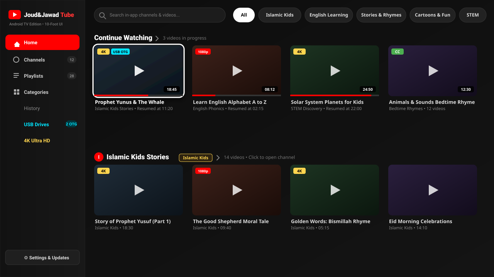
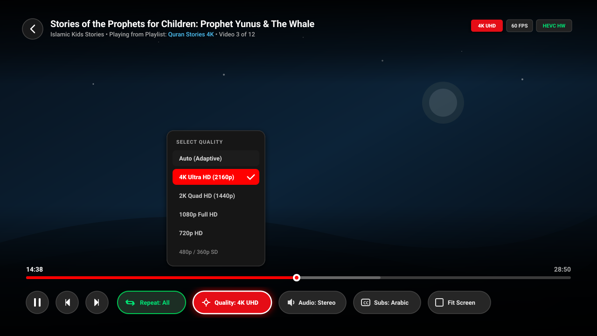
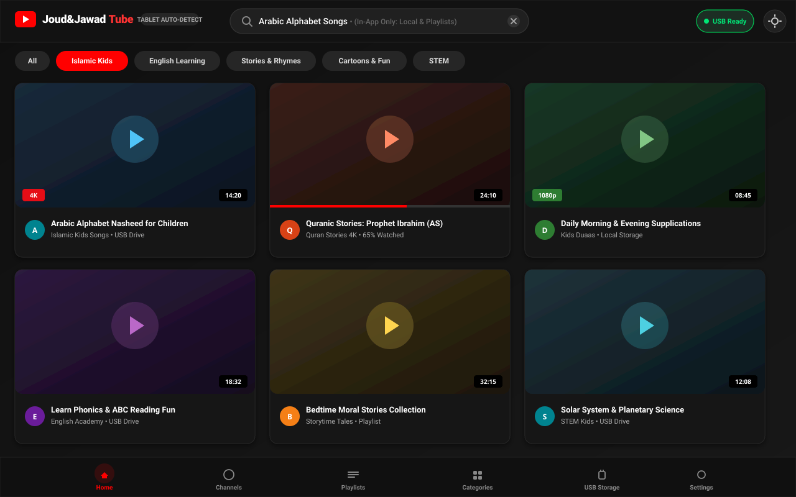
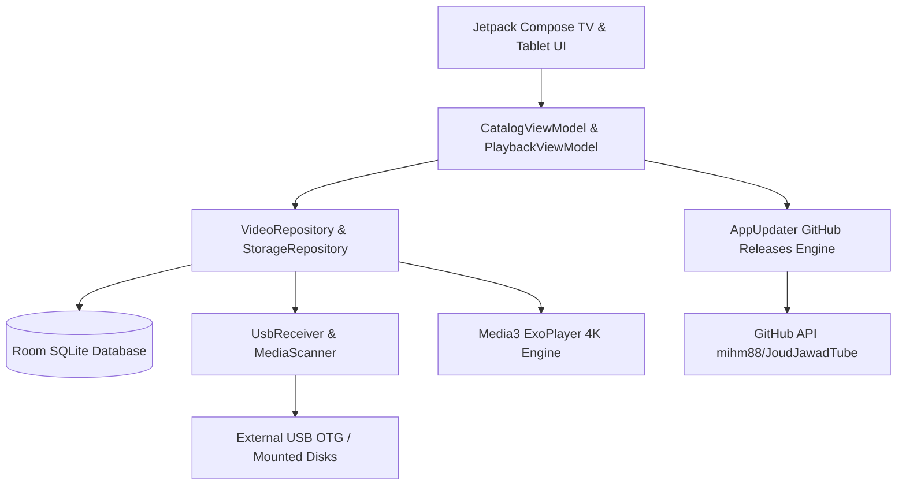

# Joud&Jawad Tube 📺✨

<div align="center">

[](#)
[-blue.svg)](#)
[-orange.svg)](#)
[](#)
[-teal.svg)](#)
[](#)
[](#)
[](LICENSE)
[](https://github.com/mihm88/JoudJawadTube/releases)

**A high-performance, child-safe, YouTube-style local and external video player designed from the ground up for Android TV, Google TV, and Android Tablets.**

[Features](#-key-features) • [Screenshots](#-screenshots) • [Architecture](#-architecture--tech-stack) • [Remote Navigation](#-tv-remote--navigation-guide) • [Auto-Updater](#-in-app-auto-updater--cicd) • [Building](#-getting-started--building)

</div>

---

## 📖 Overview

**Joud&Jawad Tube** combines the polished, 10-foot Leanback user experience of **SmartTube** with a 100% private, distraction-free local media player. Built with **Kotlin**, **Jetpack Compose for TV**, and **AndroidX Media3 (ExoPlayer)**, it plays your 4K movies, educational series, cartoons, and home videos from internal storage, SD cards, and USB OTG thumb drives.

### Why Joud&Jawad Tube?
- **Child-Friendly & Distraction-Free**: No recommendation algorithms, no tracking, and no external queries.
- **TV & Tablet First**: Seamlessly adapts between a 10-foot D-pad remote experience and responsive touch grids.
- **True 4K Hardware Playback**: Ultra-smooth 60 FPS video decoding with resolution switches, audio track selection, and multilingual subtitles.
- **Plug-and-Play USB OTG**: Auto-detects external hard drives and flash sticks, categorizing files into beautiful playlists.

---

## 📸 Screenshots

### 1. Android TV 10-Foot Leanback Interface
Featuring an Obsidian dark theme, glowing D-pad focus indicators, category pills, and an organized sidebar.
<p align="center">
  
</p>

### 2. 4K Player HUD with Resolution & Repeat Selector
ExoPlayer Media3 player HUD with resolution switcher (4K, 2K, 1080p, 720p, Auto), repeat modes (One/All), audio track switching, and sidecar subtitles.
<p align="center">
  
</p>

### 3. Responsive Tablet Adaptive Grid
Auto-detected tablet layout displaying adaptive 3-column video cards, scoped in-app search, category chips, and a bottom navigation bar.
<p align="center">
  
</p>

---

## 🌟 Key Features

### 📺 1. Android TV 10-Foot UI & Remote Navigation
- **Jetpack Compose for TV**: Powered by `androidx.tv:tv-material`, delivering fluid 60 FPS transitions.
- **High-Contrast Glow Focus Rings**: Clearly highlights the active card, button, or search field across living room viewing distances.
- **D-Pad Optimized**: Full directional remote support (`DPAD_CENTER`, `UP`, `DOWN`, `LEFT`, `RIGHT`, `BACK`, `MEDIA_PLAY_PAUSE`).

### 📱 2. Automatic Device Type Detection
- The app automatically queries `UiModeManager` and system feature flags (`PackageManager.FEATURE_LEANBACK`).
- Adjusts layouts dynamically between **TV Leanback rows** and **Tablet responsive multi-column grids** without requiring manual configuration.

### 🔍 3. Scoped In-App Search
- Dedicated search bar accepting direct on-screen keyboard, remote typing, and voice input.
- **100% Local Scope**: Filters exclusively through already-added channels, playlists, local videos, and USB files.
- Zero network telemetry or third-party query lookups.

### 🗂️ 4. Organized Sidebar & Category Navigation
- **Channels**: Browse content grouped by creator or family collection.
- **Playlists**: View custom and auto-generated folder playlists.
- **Categories**: Browse channels and playlists organized by genre (**Islamic Kids**, **English Learning**, **Stories & Rhymes**, **Cartoons & Fun**, **STEM**).
- **Interactive Headers**: Clicking playlist or channel names on the home page navigates directly to their dedicated view.

### 🎬 5. Media3 ExoPlayer 4K Engine
- **Resolution Selector**: Switch resolutions on the fly (`Auto`, `4K UHD (2160p)`, `2K QHD (1440p)`, `1080p`, `720p`, `480p`, `360p`).
- **Repeat Playback**:
  - `OFF`: Plays through list and stops.
  - `REPEAT_ONE`: Continuously loops current video.
  - `REPEAT_ALL`: Loops through the current playlist indefinitely.
- **Sidecar Subtitles**: Automatic discovery and pairing of `.srt`, `.vtt`, `.ass`, and `.ssa` subtitle files sharing the video's filename.
- **Audio Tracks**: Switch between multi-language audio streams and AAC/AC3/E-AC3 audio formats.
- **State Preservation**: Returning from video playback restores your exact scroll and focus position on the home catalog.

### 💾 6. Plug-and-Play USB Storage & OTG Handling
- Listens for `Intent.ACTION_MEDIA_MOUNTED` to detect USB flash drives and external hard disks in real time.
- Uses Android Storage Access Framework (SAF) and `MANAGE_EXTERNAL_STORAGE` for complete TV file system access.
- Extracts high-resolution video thumbnails asynchronously and caches them in Room DB.

### 🔄 7. In-App GitHub Releases Auto-Updater
- Checks the GitHub Releases API (`mihm88/JoudJawadTube`) for new version tags.
- In-app notification card displays release notes, download progress bar, and triggers `FileProvider` package installation.
- Fully automated CI/CD workflow builds release APKs on push.

### 🌐 8. Arabic Language & RTL Support
- **Full Modern Standard Arabic Translation**: Comprehensive localization across every screen, dialog, row, and setting.
- **True Right-to-Left (RTL) Layout**: Sidebars, grids, chips, and navigation automatically mirror when Arabic is active.
- **Language Selector in Settings**:
  - `Follow system` (Default: automatically detects Arabic on Arabic devices; falls back cleanly to English for others).
  - `English` (Forced English display).
  - `العربية` (Forced Arabic display).
- **Physical Player LTR Timeline**: As per YouTube & Android TV media guidelines, the video seekbar, playback elapsed times, and D-pad scrubbing remain left-to-right for consistent intuitive control.

### 🎨 9. Light Mode & System Theme Following
- **Dynamic Obsidian & Light Palettes**:
  - `Follow system` (Default: automatically matches device day/night mode).
  - `Dark` (Classic SmartTube Obsidian `#0F0F0F` theme).
  - `Light` (Clean, high-contrast `#F8F9FA` theme with AA-contrast text & focus borders).
- **Video Player HUD Stays Dark**: The player overlay retains its cinematic dark scrim in both themes for maximum video viewing contrast.

### 🔐 10. Production Release Signing & Hardened Security
- **Persistent Release Key**: Signed with a dedicated 4096-bit RSA certificate valid until 2054, eliminating mismatch update errors.
- **v1, v2, and v3 Signature Schemes**: Full security and compatibility across Android 6.0 (API 23) through Android 16 (API 36).
- **Certificate SHA-256 Fingerprint**:
  `9D:70:A7:A6:3A:1D:71:3F:FA:40:DD:EA:4E:CD:15:F1:F5:EA:88:9C:A9:0F:B1:59:60:B2:CC:2F:40:66:B0:82`
- **Permission Hardening**: Explicit `tools:node="remove"` guards prevent dependencies from injecting SMS, location, microphone, camera, or phone-state capabilities.
- **R8 Code & Resource Shrinking**: Release APK size reduced by 82% (from 22.2 MB to **4.06 MB**).
- For complete details, see [Release Signing Guide](docs/RELEASE_SIGNING_Antigravity.md) and [Play Protect Investigation Guide](docs/PLAY_PROTECT_Antigravity.md).

---

## 🎮 TV Remote & Navigation Guide

| Remote Key / Input | Action on Android TV | Action on Tablet |
|:---|:---|:---|
| **DPAD_CENTER / ENTER** | Select focused item / Open video | Tap to select / play |
| **DPAD_UP / DOWN** | Move between category chips, catalog rows, and HUD controls | Vertical scroll |
| **DPAD_LEFT / RIGHT** | Browse horizontal row videos / Seek ±10s in player | Swipe / Seekbar scrub |
| **BACK** | Hide HUD / Return to catalog (preserves scroll position) | System Back gesture |
| **MEDIA_PLAY_PAUSE** | Toggle Play / Pause instantly | Tap center screen |
| **MEDIA_FAST_FWD / REW** | Fast-forward / Rewind 30s | Double-tap right / left |
| **MENU / CONTEXT** | Open video options (Repeat, Quality, Subtitles) | 3-dots menu button |

---

## 📁 Storage & Folder Organization

To get the most out of automatic playlist creation and categorization, organize your USB drives or internal storage folders as follows:

```
USB_DRIVE/
├── Islamic Kids/
│   ├── Quran Stories/
│   │   ├── Prophet_Yunus_4K.mp4
│   │   ├── Prophet_Yunus_4K.en.srt    <-- External Sidecar Subtitle
│   │   └── Prophet_Ibrahim_4K.mkv
│   └── Nasheeds/
│       ├── Arabic_Alphabet.mp4
│       └── Morning_Supplications.mp4
├── English Learning/
│   └── Phonics/
│       ├── ABC_Phonics_Episode_1.mp4
│       └── ABC_Phonics_Episode_2.mp4
└── Cartoons/
    └── Moral Stories/
        ├── The_Honest_Boy.mp4
        └── Kindness_To_Animals.mp4
```

> [!TIP]
> **Sidecar Subtitle Pairing**: Name your subtitle file with the exact same base name as the video file (e.g., `VideoTitle.mp4` paired with `VideoTitle.srt` or `VideoTitle.ar.srt`). The scanner will automatically load it.

---

## 🏗️ Architecture & Tech Stack



- **Language**: Kotlin 1.9.22
- **UI Framework**: Jetpack Compose (1.6.2) & Jetpack Compose for TV (`androidx.tv:tv-material:1.0.0-alpha10`)
- **Media Engine**: AndroidX Media3 ExoPlayer (`1.3.1`)
- **Database & Cache**: AndroidX Room (`2.6.1`) with SQLite
- **Image Pipeline**: Coil Compose (`2.6.0`)
- **Coroutines & Reactive State**: Kotlin Coroutines & StateFlow
- **Minimum SDK**: Android 6.0 (API 23)
- **Target SDK**: Android 14 (API 34)

---

## 🚀 In-App Auto-Updater & CI/CD

The app features an integrated updater (`AppUpdater_Antigravity.kt`) wired to GitHub Releases:

1. **GitHub Actions Workflow** (`.github/workflows/android-release_Antigravity.yml`):
   - Whenever code is pushed to `master` or a release tag `v*` is created, GitHub Actions automatically builds the APK, signs it, and publishes a new GitHub Release.
2. **In-App Detection**:
   - The app checks `https://api.github.com/repos/mihm88/JoudJawadTube/releases/latest`.
   - Compares the semantic version tag with `BuildConfig.VERSION_NAME`.
3. **One-Click Update**:
   - Displays a download progress bar in **Settings > Check for Updates**.
   - Invokes `FileProvider` (`content://com.joudjawadtube.player.provider/cache_apks/...`) to initiate the standard Android package installer.

---

## 🛠️ Getting Started & Building

### Prerequisites
- **Android Studio Iguana | Hedgehog** or newer
- **JDK 17** (configured in Gradle)
- **Android SDK Platform 34** and **Build-Tools 34.0.0**

### Clone the Repository
```bash
git clone https://github.com/mihm88/JoudJawadTube.git
cd JoudJawadTube
```

### Build Release APK
```bash
# On Windows PowerShell
.\gradlew.bat assembleRelease

# On macOS / Linux
./gradlew assembleRelease
```
The optimized signed release APK will be generated at:
```
app/build/outputs/apk/release/JoudJawadTube-v1.1.0.apk
```
(A pre-compiled copy is also kept ready at the repository root: `JoudJawadTube-v1.1.0.apk`)

### Run Unit Tests
```bash
.\gradlew.bat testDebugUnitTest
```

### Install onto Android TV via ADB
> [!NOTE]
> **One-Time Reinstall Notice**: If upgrading from an older debug-signed build (v1.0.0), uninstall the previous version once before installing this production-signed release:
> `adb uninstall com.joudjawadtube.player`

1. Enable **Developer Options** and **Network Debugging** on your Android TV.
2. Connect to your TV's IP address:
```bash
adb connect 192.168.1.xxx:5555
adb install -r JoudJawadTube-v1.1.0.apk
```

---

## 📜 License

This project is licensed under the **MIT License** - see the [LICENSE](LICENSE) file for details.

---

<div align="center">
  <sub>Developed with ❤️ for safe, beautiful family entertainment on Android TV and Tablets.</sub>
</div>
