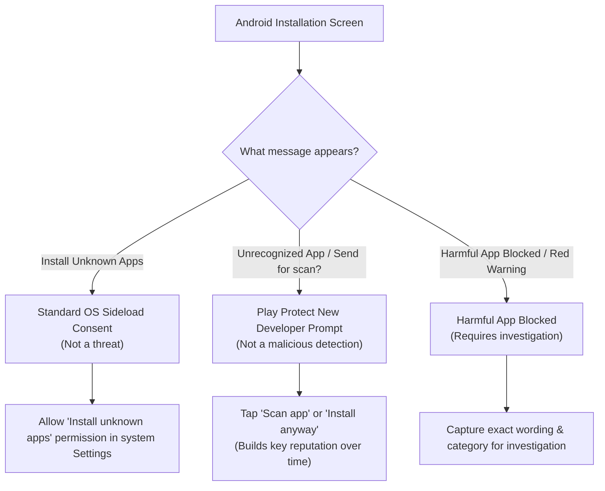

# Google Play Protect & Sideloading Investigation Guide 🛡️

This guide explains how to audit, interpret, and resolve Google Play Protect notifications when sideloading **Joud&Jawad Tube** on Android TV and tablets.

---

## 🚦 Distinguishing Prompts from Actual Detections

When installing APKs outside the Google Play Store, Android displays standard system prompts that are often confused with security detections:

### 1. "Install unknown apps" / "For your security, your phone/TV is not allowed to install unknown apps from this source"
* **Classification**: **Standard Android OS security gate** (SAF / PackageInstaller).
* **Cause**: The app or file manager launching the APK (e.g., Files app, Chrome, USB file manager) hasn't been granted `REQUEST_INSTALL_PACKAGES` permission yet.
* **Resolution**: Tap **Settings** in the dialog and toggle **Allow from this source**.

### 2. "Unrecognized app" / "Send app for a security scan?" / "Play Protect doesn't recognize this app's developer"
* **Classification**: **New Key Reputation Prompt** (Informational, NOT a malware alert).
* **Cause**: The production signing certificate is newly generated and has not yet been scanned by Google's cloud reputation database across thousands of devices.
* **Resolution**:
  - Tapping **Scan app** sends the APK to Google's cloud scanner to verify safety and build positive developer reputation.
  - Tapping **Install without scanning** / **Install anyway** installs the app immediately.
  - Consistent signing with the same release key over time naturally diminishes this prompt.

### 3. "Harmful app blocked" / "Blocked by Play Protect"
* **Classification**: **Actual Security Threat Detection**.
* **Symptoms**: Red dialog with a specific classification (e.g., *Trojan*, *Spyware*, *Phishing*, *Harmful app*).
* **Action**:
  1. Do not proceed until investigated.
  2. Capture the exact warning title, body text, and category code.
  3. Verify the APK's SHA-256 certificate using `apksigner verify --print-certs` to ensure the file was not modified in transit.

---

## 🔍 Investigation Checklist for Joud&Jawad Tube

Our production build has been systematically hardened against avoidable flags:

| Check Item | Status in Joud&Jawad Tube v1.1.0 | Protection Details |
|:---|:---|:---|
| **Release Signing Key** | ✅ **Persistent RSA 4096-bit** | Self-signed PKCS12 key valid until 2054; replaces random debug keys. |
| **Signature Schemes** | ✅ **v1, v2, v3 Enabled** | Full integrity verification from Android 6.0 (API 23) to Android 16 (API 36). |
| **Target SDK Version** | ✅ **Android 16 (API 36)** | Targets the latest modern Android platform standard. |
| **Cleartext HTTP Traffic** | ✅ **Disabled (`false`)** | Network Security Config enforces pure TLS / HTTPS for all streams & APIs. |
| **Unnecessary Permissions** | ✅ **Strict Guard (`tools:node="remove"`)** | Zero SMS, zero Location, zero Contacts, zero Audio, zero Camera, zero Phone state. |
| **Ad / Tracking Libraries** | ✅ **100% Zero** | No third-party ad networks, telemetry trackers, or suspicious native libraries. |
| **Code Minification** | ✅ **R8 & ProGuard Enabled** | Shrinks APK from 22MB to 4MB, eliminating dead code and optimizing resources. |
| **In-App Updater Integrity**| ✅ **Package Verification** | Validates downloaded updates against `com.joudjawadtube.player` before install. |

---

## 📋 Steps to Check Play Protect History on Device

1. Open the **Google Play Store** on your Android TV or tablet.
2. Tap your **Profile icon** at the top right.
3. Select **Play Protect**.
4. Check the status: **"No harmful apps found"**.
5. Tap **Scan** to run an on-demand scan of installed applications.

---

## 🔗 Official Android Documentation Links

* [Google Play Protect Overview](https://developers.google.com/android/play-protect)
* [Play Protect Security Appeals](https://support.google.com/googleplay/android-developer/contact/protectappeals)
* [Android App Signing Best Practices](https://developer.android.com/studio/publish/app-signing)
* [Android Network Security Configuration](https://developer.android.com/privacy-and-security/security-config)
* [Android 16 Behavior Changes](https://developer.android.com/about/versions/16/behavior-changes-16)
